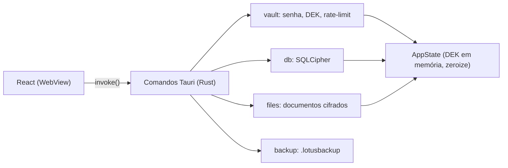
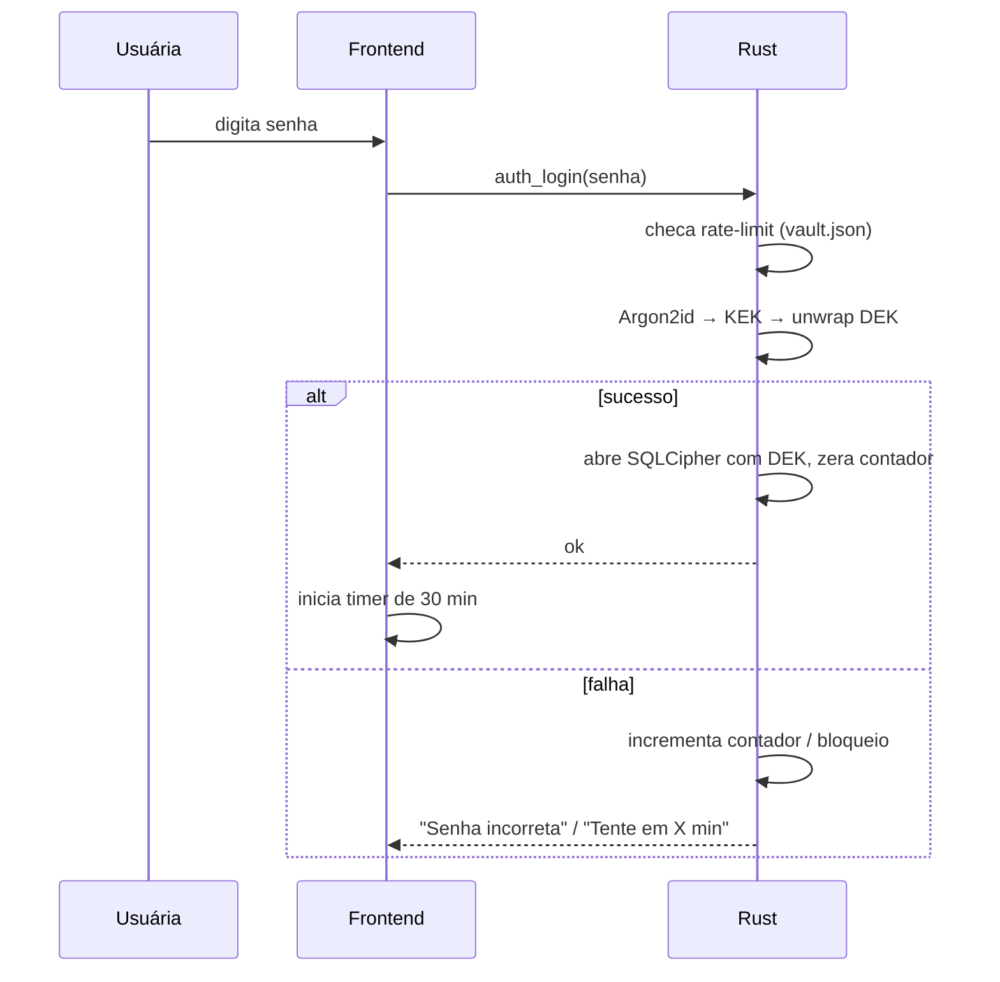

# Arquitetura Técnica

> Subordinado a `01_FONTE_DA_VERDADE.md`. Em caso de conflito, vale a Fonte da Verdade.

## 1. Visão geral



## 2. Estrutura de pastas do projeto

```
Sistema Pacientes/
├── AGENTS.md                    # regra para IAs → ler Planejamento/01
├── Planejamento/                # este planejamento
├── app/                         # projeto Tauri
│   ├── package.json
│   ├── index.html
│   ├── tailwind.config.ts       # tokens de cor da identidade
│   ├── src/
│   │   ├── main.tsx / App.tsx   # rotas + guarda de sessão
│   │   ├── assets/              # logo LC, fontes locais
│   │   ├── lib/
│   │   │   ├── api.ts           # wrappers tipados de invoke
│   │   │   ├── types.ts         # Paciente, Sessao, Documento...
│   │   │   ├── format.ts        # datas dd/mm/aaaa, idade, telefone
│   │   │   └── idle.ts          # detector de inatividade (30 min)
│   │   ├── components/          # Layout, Sidebar, Button, Modal, ConfirmDialog, Toast, EmptyState
│   │   └── pages/               # PrimeiroAcesso, Login, Recuperar, Inicio, Pacientes, PacienteForm,
│   │                            # PacientePerfil, Documentos, Configuracoes
│   └── src-tauri/
│       ├── Cargo.toml
│       ├── tauri.conf.json      # CSP restrita, sem rede
│       ├── capabilities/        # permissões mínimas (dialog, opener restrito)
│       ├── migrations/001_inicial.sql
│       └── src/
│           ├── main.rs / lib.rs
│           ├── state.rs         # AppState { dek: Mutex<Option<Key>>, conn: Mutex<Option<Connection>> }
│           ├── error.rs
│           ├── crypto.rs        # argon2id, xchacha, geração de chave de recuperação
│           ├── vault.rs         # vault.json, wrap/unwrap DEK, rate-limit
│           ├── db.rs            # abrir SQLCipher, migrações
│           ├── files.rs         # cifrar/decifrar documentos, temporários
│           ├── backup.rs
│           ├── text.rs          # normalização sem acento
│           └── commands/{auth,pacientes,sessoes,aniversarios,documentos,categorias,backup,config}.rs
```

## 3. Comandos Tauri (contrato)

| Módulo | Comando | Entrada → Saída |
|---|---|---|
| auth | `auth_status` | → `{ configurado, bloqueado_ate? }` |
| | `auth_setup` | `senha` → `{ chave_recuperacao }` |
| | `auth_login` | `senha` → `ok` \| erro genérico / bloqueio |
| | `auth_lock` | → `ok` (apaga DEK) |
| | `auth_change_password` | `atual, nova` → `ok` |
| | `auth_recover` | `chave, nova_senha` → `ok` |
| pacientes | `pacientes_listar` | `{ busca?, status? }` → `PacienteResumo[]` |
| | `paciente_obter` / `paciente_criar` / `paciente_atualizar` | |
| | `paciente_definir_status` | `id, status` |
| | `paciente_excluir` | `id, confirmacao_nome` |
| sessões | `sessoes_listar` | `paciente_id` → `Sessao[]` (desc) |
| | `sessao_criar` / `sessao_atualizar` / `sessao_excluir` | |
| aniversários | `aniversariantes` | `{ dias: 0..7 }` → `Aniversariante[]` |
| | `whatsapp_parabens` | `paciente_id` → abre wa.me (único link externo) |
| documentos | `documentos_listar` | `{ busca?, categoria_id? }` |
| | `documento_enviar` | `caminho_origem, categoria_id, descricao?` |
| | `documento_baixar` | `id, caminho_destino` |
| | `documento_abrir` | `id` |
| | `documento_atualizar` / `documento_excluir` | |
| categorias | `categorias_listar` / `categoria_criar` / `categoria_renomear` / `categoria_excluir` | |
| backup | `backup_criar` | `caminho_destino` → `{ tamanho, verificado }` |
| | `backup_inspecionar` | `caminho, senha` → `{ data, n_pacientes, n_documentos }` |
| | `backup_restaurar` | `caminho, senha` |
| config | `config_obter` / `config_definir` | mensagem de aniversário, último backup |
| financeiro | `financeiro_listar` | `{ ano_mes, tipo?, busca? }` → `LancamentoFinanceiro[]` |
| | `financeiro_resumo_mensal` | `{ ano_mes }` → `ResumoFinanceiroMensal` |
| | `financeiro_criar` / `financeiro_atualizar` / `financeiro_excluir` | |
| grade_semanal | `horarios_semanais_listar` | `{ paciente_id? }` → `HorarioSemanal[]` |
| | `horario_semanal_criar` / `horario_semanal_atualizar` / `horario_semanal_excluir` | |
| | `horarios_semanais_aplicar_semana` | `{ data_referencia }` → `ResultadoAplicarGradeSemana` |

**Regras dos comandos:**
- Todo comando de dados verifica se o app está desbloqueado. Se não estiver, retorna `Erro::Bloqueado` e o frontend redireciona para o Login.
- Caminhos de arquivo vêm dos diálogos nativos (plugin `dialog`) e são abertos no Rust.

## 4. Fluxos-chave



**Bloqueio por inatividade:**
- `idle.ts` escuta eventos de mouse/teclado. Aos 30 min, chama `auth_lock` e mostra a tela de bloqueio **sobre** a rota atual.
- O estado React não é desmontado, então o rascunho não se perde.
- Após o desbloqueio, a tela volta exatamente para onde estava.

## 5. Testes mínimos
- `crypto`: wrap/unwrap ida e volta; senha errada falha; chave de recuperação funciona.
- `vault`: rate-limit (5 erros → bloqueio; persiste após reiniciar; dobra o tempo).
- `text`: "João" ≈ "joao"; busca por telefone com e sem máscara.
- `aniversarios`: hoje, próximos 7 dias, virada de ano, 29/02.
- `sessoes`: rejeita data futura e mais de 600 caracteres.
- `files`: cifra/decifra arquivo de 25 MB; rejeita extensão ou magic bytes inválidos.
- `backup`: criar → restaurar em pasta limpa → dados idênticos.
