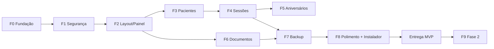

# Roadmap de Execução

> Cada tarefa referencia regras (RNxx) e telas (Txx) da `01_FONTE_DA_VERDADE.md`.
> Ao concluir uma tarefa, marque `[x]` e anote o commit.
> Execute as fases **em ordem**. Uma tarefa só começa quando suas dependências estiverem prontas.

**Marco de uso real:** ao final de **F4**, a usuária já pode começar a usar o app, conforme a prioridade escolhida por ela (pergunta 7.1). Gere um instalador provisório nesse momento.

---

## F0 — Fundação do projeto
- [x] **F0-T1** Criar o projeto Tauri 2 + React + TS + Vite em `app/` e configurar Tailwind com os tokens de cor (seção 4). (`941206c`)
- [x] **F0-T2** Configurar segurança do Tauri: (`8d78090`)
  - CSP restrita.
  - Capabilities mínimas.
  - Sem HTTP.
  - Desabilitar devtools em release.
- [x] **F0-T3** Adicionar dependências Rust: (`b385a35`)
  - `rusqlite` (bundled-sqlcipher)
  - `argon2`, `chacha20poly1305`, `zeroize`, `uuid`, `serde`, `thiserror`
  - `unicode-normalization`, `chrono`
- [x] **F0-T4** Criar o esqueleto dos módulos Rust (seção 2 da Arquitetura), `AppState` e `error.rs`. (`5c05072`)
- [x] **F0-T5** Lint/format (clippy, rustfmt, eslint, prettier) e scripts `npm run dev/test/build`. (`36256cd`)
- [x] **F0-T6** Exportar o logo LC do PDF para `src/assets` e embutir a fonte local. (`a877371`)

**Aceite:** `npm run tauri dev` abre uma janela com o logo e as cores; nenhuma requisição de rede.

## F1 — Núcleo de segurança (RN01–RN08, seção 7)
- [x] **F1-T1** `crypto.rs`: (`f7d21d8`)
  - Argon2id.
  - Wrap/unwrap da DEK com XChaCha20-Poly1305.
  - Gerador da chave de recuperação.
  - Testes.
- [x] **F1-T2** `vault.rs`: ler/gravar `vault.json` de forma atômica e persistir o rate-limit (RN04). Testes. (`8d2c09d`)
- [x] **F1-T3** `db.rs`: abrir SQLCipher com a DEK, WAL, foreign_keys e migração `001_inicial.sql` (seção 6). (`62b849a`)
- [x] **F1-T4** Comandos `auth_*` (status, setup, login, lock, change_password, recover). (`3b3b7d9`)
- [x] **F1-T5** Telas T01 (primeiro acesso + imprimir chave), T02 (login com aviso de bloqueio) e T03 (recuperar).
- [ ] **F1-T6** `idle.ts`: bloqueio após 30 min, sem perder o estado (RN05); botão Sair (RN06).
- [ ] **F1-T7** Limpar temporários e zerar a DEK no lock e ao fechar a janela.

**Aceite:**
- O banco em disco não abre sem a chave (testar com `sqlite3`).
- 5 erros de senha bloqueiam o login, e reiniciar não desbloqueia.
- A chave de recuperação redefine a senha.

## F2 — Layout e Painel inicial (T04)
- [ ] **F2-T1** Componentes base:
  - Layout, Sidebar (Início · Pacientes · Documentos · Configurações · Sair)
  - Button, Input, Modal, ConfirmDialog, Toast, EmptyState
- [ ] **F2-T2** Rotas com guarda (bloqueado → login).
- [ ] **F2-T3** Painel com saudação, atalhos, total de ativos e espaço reservado para aniversariantes e backup.

**Aceite:** navegação entre as áreas em até 2 cliques; texto ≥ 16px; contraste AA.

## F3 — Pacientes (RN10–RN19, T05–T07)
- [ ] **F3-T1** `text.rs`: normalização sem acento + comandos CRUD de pacientes. Testes.
- [ ] **F3-T2** Lista T05 com busca instantânea (nome/telefone), filtro de status e colunas definidas.
- [ ] **F3-T3** Formulário T06 em grupos:
  - Máscara de telefone e data.
  - Destaque dos campos de responsável para menores de 18 (RN13).
  - Só o nome é obrigatório.
- [ ] **F3-T4** Perfil T07: cabeçalho, dados cadastrais, área reservada para sessões e Mais opções (inativar/reativar/excluir com digitação do nome — RN14, RN18).

**Aceite:** criar, editar, buscar "joao" → "João", inativar e reativar, excluir com confirmação.

## F4 — Sessões (RN20–RN27, T08)
- [ ] **F4-T1** Comandos de sessões com validação (data não futura, ≤ 600 caracteres). Testes.
- [ ] **F4-T2** Modal T08 com contador 0/600 e data padrão = hoje.
- [ ] **F4-T3** Histórico compacto no perfil:
  - Ordem decrescente.
  - Selo "(editado)".
  - Editar/excluir.
  - Total de sessões e data da última.
- [ ] **F4-T4** Atalho "Registrar sessão" no painel: busca rápida de paciente → modal.
- [ ] **F4-T5** 🎯 **Instalador provisório** para a usuária começar a usar e dar feedback.

**Aceite:** registrar 3 sessões, editar 1 e excluir 1; o bloqueio de 30 min durante a digitação não perde o texto.

## F5 — Aniversariantes (RN30–RN34)
- [ ] **F5-T1** Comando `aniversariantes` (hoje + 7 dias, inclui inativos, regra do 29/02). Testes.
- [ ] **F5-T2** Card no painel com o botão "Enviar parabéns no WhatsApp" (`wa.me`, só com clique).
- [ ] **F5-T3** Mensagem padrão editável em Configurações (RN32).

**Aceite:** paciente inativo que faz aniversário hoje aparece; o botão abre o WhatsApp com a mensagem preenchida.

## F6 — Documentos (RN40–RN48, T09)
- [ ] **F6-T1** `files.rs`: validação (extensão + magic bytes + 25 MB) e cifragem em blocos. Testes.
- [ ] **F6-T2** Categorias: seed (Modelos, Administrativo, Outros) e CRUD (RN41).
- [ ] **F6-T3** Comandos enviar/listar/baixar/abrir/atualizar/excluir.
- [ ] **F6-T4** Tela T09: abas de categoria, busca, enviar (botão + arrastar e soltar) e ações por arquivo.

**Aceite:** enviar PDF e DOCX, baixar idêntico (sha256 igual), arquivo em disco ilegível, rejeitar `.exe` renomeado para `.pdf`.

## F7 — Backup e restauração (RN50–RN55)
- [ ] **F7-T1** `backup.rs`: empacotar banco (checkpoint WAL) + docs + vault → `.lcbackup` cifrado, com verificação pós-gravação.
- [ ] **F7-T2** Inspecionar e restaurar, com cópia automática prévia dos dados atuais.
- [ ] **F7-T3** Interface: botão no painel e em Configurações, data do último backup e lembrete após 7 dias.
- [ ] **F7-T4** Escrever um guia de 1 página para a usuária: "Como fazer backup e restaurar" (`docs/guia-backup.md` → PDF).

**Aceite:** backup → apagar a pasta de dados → restaurar → tudo idêntico. Abrir com a chave de recuperação também funciona.

## F8 — Configurações, polimento e entrega
- [ ] **F8-T1** Tela T10 completa: trocar senha, backup/restaurar, mensagem, categorias, Sobre.
- [ ] **F8-T2** Revisão de UX com a usuária (sessão de teste guiada, anotar ajustes).
- [ ] **F8-T3** Auditoria de segurança:
  - Zero rede (verificar com firewall/monitor).
  - Logs limpos.
  - `cargo audit` / `npm audit`.
- [ ] **F8-T4** Instalador Windows final, ícone LC, nome "LC Pacientes".
- [ ] **F8-T5** Instalar no computador dela, criar senha junto com ela, imprimir a chave e fazer o primeiro backup.

**Aceite (Entrega MVP):** todos os critérios das fases F0–F7 OK e a usuária completa sozinha o fluxo "cadastrar paciente → registrar sessão → enviar documento → backup".

## F9 — Fase 2 (após o MVP estabilizar)
- [ ] **F9-T1** Levantar detalhes do financeiro e da agenda com a usuária. Atualizar a Fonte da Verdade **antes** de codar.
- [ ] **F9-T2** Financeiro: entradas/gastos, vínculo opcional ao paciente e resumo mensal.
- [ ] **F9-T3** Grade semanal de horários fixos.
