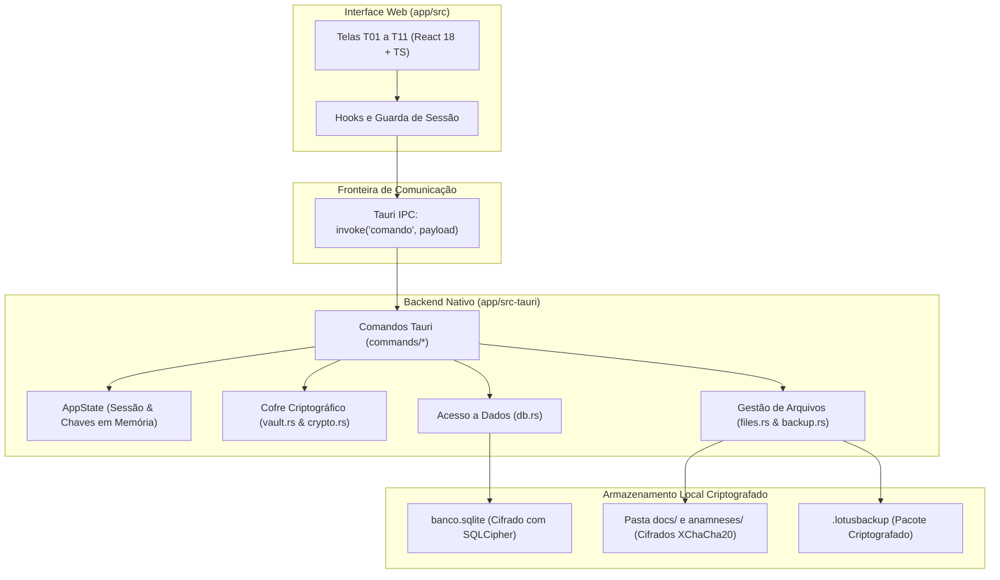

# 03 — Arquitetura e Decisões Técnicas (ADRs)

**Projeto:** LotusPsi (Sistema de Pacientes e Documentos — LC Consultório)  
**Versão:** 1.1 — 02/11/2026  
**Documentos Complementares:** [`Planejamento/02_ARQUITETURA.md`](../Planejamento/02_ARQUITETURA.md)

---

## 1. Visão Arquitetural

---

## 2. Registros de Decisões de Arquitetura (ADRs)

### ADR-001: Aplicação Desktop Tauri 2 em vez de Web/SaaS em Nuvem
- **Status:** Aprovada (01/11/2026)
- **Contexto:** Prontuários psicológicos contêm dados ultrassensíveis. Soluções SaaS exigem mensalidades contínuas de hospedagem e introduzem risco de vazamentos em nuvem.
- **Decisão:** Construir como aplicação desktop local utilizando **Tauri 2** (Rust + webview nativa).
- **Consequências:** Custo operacional zero de infraestrutura, independência de conexão à internet, privacidade médica máxima e binário final leve (~15 MB).

### ADR-002: SQLite Criptografado com SQLCipher em Repouso
- **Status:** Aprovada (01/11/2026)
- **Contexto:** Os dados relacionais de pacientes, atendimentos e agendamentos precisam estar salvos localmente, mas não podem estar em texto claro caso o computador seja acessado ou furtado.
- **Decisão:** Utilizar SQLite compilado com **SQLCipher** (`rusqlite` com a feature `bundled-sqlcipher`), operando com modo WAL e integridade transacional.
- **Consequências:** O arquivo `.sqlite` em disco é ilegível sem a chave derivada correta. Antes de backups é necessário efetuar `wal_checkpoint(TRUNCATE)`.

### ADR-003: XChaCha20-Poly1305 para Documentos e Backups (.lotusbackup)
- **Status:** Aprovada (01/11/2026)
- **Contexto:** Além do banco relacional, a usuária anexa arquivos PDF/DOCX (modelos, declarações e anamneses) e gera arquivos de backup para pendrives.
- **Decisão:** Criptografia autenticada com **XChaCha20-Poly1305**, gerando nonces de 192 bits aleatórios e arquivo proprietário `.lotusbackup` contendo checksum SHA-256 e verificação pós-gravação.
- **Consequências:** Proteção contra manipulação acidental e impossibilidade de reutilização perigosa de nonces.

### ADR-004: KDF Argon2id e Chave Física de Recuperação em Papel
- **Status:** Aprovada (01/11/2026)
- **Contexto:** A usuária única pode esquecer a senha mestra. Como o sistema é offline e não há e-mail de recuperação, esquecer a senha causaria perda irreversível de prontuários de anos.
- **Decisão:** A chave mestra de dados (DEK) é cifrada por duas chaves distintas derivadas via **Argon2id**: uma pela senha da usuária (KEK_senha) e outra por uma chave mestra de emergência física (KEK_rec) impressa em papel no primeiro acesso.
- **Consequências:** A usuária pode recuperar todo o sistema apresentando a folha de papel com a chave impressa, sem comprometer a segurança caso a senha seja perdida.

### ADR-005: Anamnese como Anexo de Arquivo no Perfil (Sem Formulário)
- **Status:** Aprovada (02/11/2026)
- **Contexto:** A psicóloga já possui modelos próprios de anamnese impressos ou preenchidos no Word/PDF. Criar um formulário engessado de anamnese traria retrabalho desnecessário.
- **Decisão:** Incorporar a anamnese no perfil do paciente exclusivamente como anexo de arquivo digitalizado/PDF, criptografado no vault local.
- **Consequências:** Respeita o fluxo de trabalho real da profissional, reduz complexidade de formulários e reaproveita o motor `files.rs` na Fase F6.

### ADR-006: Antecipação da Agenda com Detecção de Conflitos para Fase F4.5
- **Status:** Aprovada (02/11/2026)
- **Contexto:** No feedback do instalador provisório, a usuária ressaltou a necessidade de marcar dia e horário das sessões antes de finalizar o MVP.
- **Decisão:** Antecipar a implementação da Agenda da Fase 2 para a Fase F4.5, com telas T11 (grade semanal e mensal) e aviso visual de conflito de horário sem bloqueio impeditivo.
- **Consequências:** Atende imediatamente à rotina de consultório e permite vincular o agendamento ao registro ágil de sessões diárias.
